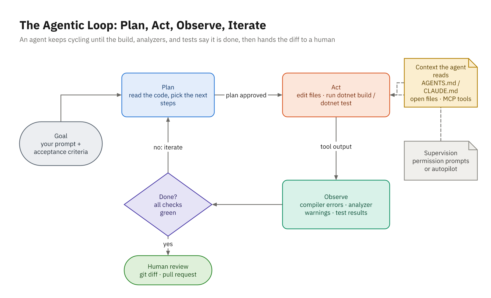

# Activity 12: Plan, Then Let the Agent Build

## Objective

Use your coding agent to add **orders** to the Bookstore API: placing an order prices it with the
existing `PriceCalculator`, takes the copies off the shelf with `Book.RemoveStock`, and saves it, all or
nothing. You won't write the code yourself. You will get a plan from the agent in plan mode, review and
improve that plan before any code exists, approve it at a supervision level you choose, and then judge the
result by its tests and its diff. The contract is in `TASK.md`.



*Figure: The loop your agent runs. Your leverage is the goal and acceptance criteria going in, the plan,
and the review coming out.*

## Prerequisites

- .NET 10 SDK, Git, and PowerShell 7
- GitHub Copilot (agent mode in VS Code or Visual Studio 2026, or the Copilot CLI) or Claude Code
- Activities 10 and 11 (context files), or familiarity with `AGENTS.md` and `CLAUDE.md`

## Skills Practiced

- Getting a plan from an agent in plan mode before any file changes
- Reviewing a plan for design, scope, test coverage, and unhappy paths, and editing it
- Choosing a supervision level for the implementation
- Letting the agent drive its own build-and-test loop against acceptance criteria
- Reviewing an agent's work through `git diff` and the tests, not its summary

## Instructions

Start the lab from the course repo root. This copies `begin/` to a folder outside the repo, makes it a
git repository, and commits a baseline, so `git diff` always shows exactly what you and your assistant
changed:

```powershell
.\courseware\utils\start-lab.ps1 -Activity 12
cd ~\labs\activity-12-agentic-loop-and-plan-mode
```

Open the folder (or `Bookstore.slnx`) in Visual Studio 2026 or VS Code. To start over, re-run the
command with `-Force`. The reference in `solution/` is **one acceptable result**; yours will differ.

> **In class / take-home.** In class (about 35 minutes): every step. Steps 1 and 2 come just before a
> break: send the planning prompt, leave the session open, and review the plan when you're back. Only
> the stretch goal is take-home.

1. **Read the task yourself first.** Read `TASK.md` and the "Definition of done" in `AGENTS.md`. Run
   `dotnet build` and `dotnet test --solution Bookstore.slnx` so you know the starting point is green.

   <details>
   <summary>Guided help: step 1</summary>

   You can only judge the agent's plan if you know the contract yourself.

   ```powershell
   Get-Content TASK.md
   Select-String -Path AGENTS.md -Pattern 'Definition of done' -Context 0,4
   dotnet build
   # Build succeeded. 0 Warning(s)
   dotnet test --solution Bookstore.slnx
   # Test run summary: Passed!  total: 19, failed: 0
   ```

   **Look for** the rules that are easy to skim past: **all or nothing** (a failed line changes no
   stock and saves no order); a `409` whose `detail` names each short book with the copies requested
   and available; a `400` for the same book on two lines; each line keeps a copy of the book's price;
   money stored the way `Book.Price` is (`HasConversion<double>()` in `BookstoreDbContext`). Then ask
   yourself what `TASK.md` doesn't say: what happens when two orders want the last copies at once?

   </details>

2. **Get a plan, not code.** Start a fresh agent session in the lab folder, switch to plan mode (or the
   Plan agent), and ask for a plan that implements `TASK.md`. Nothing should change on disk in this step;
   check with `git status`.

   <details>
   <summary>Guided help: step 2</summary>

   Plan mode is read-only until you approve, so a vague first plan costs nothing.

   > **GitHub Copilot:** Pick the **Plan** agent in the chat's agent picker (VS Code or Visual Studio
   > 2026). In the Copilot CLI, press Shift+Tab to reach plan mode, or start the prompt with `/plan`.
   >
   > **Claude Code:** Shift+Tab until the status bar shows plan mode, start the prompt with `/plan`, or
   > launch with `claude --permission-mode plan`.

   ```text
   Plan how to implement TASK.md, following AGENTS.md. This is planning only: change no files. In the
   plan, give me every file you'll create or change; which project holds the order placement logic,
   and why; the EF Core mapping for Order and its lines, including how money is stored; the order in
   which stock is checked and removed; the status code and body for each failure case in TASK.md; and
   the unit and API tests, mapped to the acceptance criteria. Put anything TASK.md leaves open as
   questions at the end.
   ```

   ```powershell
   git status
   # nothing to commit, working tree clean
   ```

   **Check:** the plan names files, not just ideas, and every acceptance criterion in `TASK.md` has a
   test. **If files changed anyway:** you weren't in plan mode. Run `git restore . ; git clean -fd` and
   start again in plan mode.

   </details>

3. **Review the plan.** Write down at least three changes you want before approving it. Use the review
   questions from chapter 03: where the logic lives, whether it follows the solution's patterns, packages,
   test coverage of every acceptance criterion, and what happens on the unhappy paths. Pay particular
   attention to what "all or nothing" requires, and to what happens when two orders compete for the last
   copies of a book.

   <details>
   <summary>Guided help: step 3</summary>

   Still in plan mode. Make the agent walk through the unhappy paths before you write your changes:

   ```text
   Before I approve, answer two questions about your plan. If the third line of an order is short,
   what has already happened to the stock of the first two lines, in memory and in the database? If two
   requests order the last 3 copies of the same book at the same moment, what stops both from
   succeeding?
   ```

   **Check:** for each answer, can you point to the line of the plan that guarantees it? Then ask the
   plan the rest of the review questions yourself. When a line is short, has anything else already
   changed? What stops two requests from both passing the stock check? Which exceptions become a `409`,
   and could a real bug be one of them? Where does the order time come from, and can a test control it?
   Can one API test's order change the stock another test reads? Is every failure case in `TASK.md`
   tested, and does the plan add a package?

   **If the answers sound confident but vague:** ask the agent to quote the line of its plan behind each
   answer. A guarantee that no line of the plan states isn't in the plan.

   Write down your three (or more) changes before step 4.

   <details>
   <summary>Still stuck? Show the answer</summary>

   First plans often get several of these wrong:
   - `RemoveStock` called line by line inside the loop: a short third line throws after two books have
     already changed in memory. Price first, check every line, then remove stock.
   - Read stock, check it, save: two requests can both pass the check. Nothing stops the race unless
     `Book.Stock` is a concurrency token (or something equivalent).
   - Every `InvalidOperationException` mapped to `409`: that hides real bugs. A dedicated exception
     makes the mapping exact.
   - `DateTimeOffset.UtcNow` for the order time instead of an injected `TimeProvider`.
   - API tests on a shared `IClassFixture` database: orders change stock that other tests then read.
   - The duplicate-book `400`, and any new package.

   </details>

   </details>

4. **Revise and approve.** Get the agent to revise the plan with your changes, then approve it at a level
   you can justify (for example, edits accepted automatically and commands approved one by one). Save the
   approved plan; you'll need it at the end.

   <details>
   <summary>Guided help: step 4</summary>

   Send your changes as a numbered list and ask for the whole plan back, not a diff of it. For example:

   ```text
   Revise the plan with these changes, then show me the whole revised plan:
   1. Order placement lives in Bookstore.Domain: price the order first, then check every line's stock,
      and only then call RemoveStock, so a bad coupon or one short line changes nothing.
   2. Add a dedicated exception for insufficient stock that names every short book with the copies
      requested and available. The endpoint maps only that exception to a 409 ProblemDetails.
   3. Make Book.Stock a concurrency token and map DbUpdateConcurrencyException to 409 as well, with a
      test that proves two competing saves can't both succeed.
   4. Take the order time from an injected TimeProvider, not DateTimeOffset.UtcNow.
   5. Store order money with HasConversion<double>(), like Book.Price. No new packages.
   ```

   Then approve at a level you can justify, such as edits accepted automatically and each command
   approved:

   > **GitHub Copilot:** Switch from Plan to **Agent** with the default **Manual permissions**: edits
   > land for you to keep or undo, and each terminal command asks first. Skip Autopilot here.
   >
   > **Claude Code:** Choose **Yes, auto-accept edits** if it's offered; otherwise choose **Yes,
   > manually approve edits**, then press Shift+Tab once for accept-edits mode. Before approving,
   > Ctrl+G opens the plan in your editor.

   Save the approved plan outside the lab folder (for example `~\labs\activity-12-plan.md`); step 7
   compares against it.

   </details>

5. **Let it build.** Watch the loop. Approve the build and test commands, and interrupt if it drifts outside
   the plan. Don't edit code yourself during this step; redirect the agent instead.

   <details>
   <summary>Guided help: step 5</summary>

   Start the implementation with the gates and the finish line in the prompt:

   ```text
   Implement the approved plan. After each change, run dotnet build and
   dotnet test --solution Bookstore.slnx and fix what fails. Don't change existing tests or add
   packages. Finish with the list of files you changed and the final test summary line.
   ```

   **Watch for** a red build or test followed by a fix, which is the loop working. Interrupt (Esc in a
   terminal agent, or the stop button in IDE chat) when it steps outside the plan: a new package, an
   edit to an existing test, a service layer the plan didn't have. Redirect it in words:

   ```text
   Stop: that isn't in the approved plan. Undo it and continue with the next step of the plan.
   ```

   **If it loops on the same failure** three or four times, ask it to explain the failure from the test
   output before it changes anything else.

   </details>

6. **Review the result.** When the agent says it's done, check the claim yourself: run the gates, read the
   diff, and walk through each acceptance criterion in `TASK.md`. Send any fixes back to the agent as
   specific requests.

   <details>
   <summary>Guided help: step 6</summary>

   Trust the gates and the diff, not the agent's summary:

   ```powershell
   dotnet build                                   # Build succeeded. 0 Warning(s)
   dotnet test --solution Bookstore.slnx          # Passed! (the reference has 33 tests: 19 plus 14)
   git status --short                             # new files show as ??
   git diff --stat -- tests/                      # (no output): existing tests unchanged
   git diff -- Directory.Packages.props           # (no output): no new packages
   ```

   Then run the API (`dotnet run --project src/Bookstore.Api`) and send the requests from **Expected
   behavior** below, top to bottom on a fresh database. Tick off each acceptance criterion in
   `TASK.md` as you see it.

   **Check:** the first order returns `201` with total `437.77` and a `Location` ending in
   `/api/orders/1`; book 5 drops from 20 to 10; book 4 returns `409` naming "Northern Lights Field
   Guide". **If a case is wrong** (the duplicate-book `400` is often missed), send one specific fix:

   ```text
   An order with the same bookId on two lines is accepted and priced as two lines. TASK.md says that's
   a 400 validation problem. Add the check and an API test for it; don't change other tests.
   ```

   </details>

7. **Record what happened.** In a few lines: what you changed in the plan, what the agent got wrong on its
   own, and what review caught.

   <details>
   <summary>Guided help: step 7</summary>

   A few lines is enough. If you lost track, ask the agent to draft them from the session, then correct
   the draft against your saved plan and your own notes:

   ```text
   From this session, list in three short groups: the changes I made to your first plan, the
   mistakes you made and fixed yourself in the build-and-test loop, and the problems my review found
   afterward. Quote the failing test or error where there was one.
   ```

   **Check:** compare your notes with "What review caught" in the reference's
   `solution/SOLUTION-NOTES.md` in the course repo. Concurrency, partial stock changes, and the
   duplicate-book case are the usual three.

   </details>

<details>
<summary>Prompting hints</summary>

- In the planning prompt, point the agent at `TASK.md` and `AGENTS.md` and say explicitly not to change any
  files yet.
- Ask the plan to list the files, where order placement logic lives, the EF Core mapping for the new
  entities, how stock is checked and removed, the status code for each failure, and the tests it will add.
- Ask it to list ambiguities in `TASK.md` as questions rather than guessing.
- When you review, ask how the plan keeps a failed line from changing any stock, and what stops two
  simultaneous orders from both taking the last copies.
- For implementation, include the verification commands and ask for the final test summary line and a list
  of files changed.

</details>

## Requirements

- An approved plan existed before any code changed, and you edited it at least once.
- `POST /api/orders` and `GET /api/orders/{id}` behave as `TASK.md` specifies, including every error case.
- Insufficient stock returns `409` as ProblemDetails naming the short book, and no stock changes.
- An `Order` entity (with its lines) is stored through `BookstoreDbContext`.
- Order placement has unit tests, and both endpoints have API tests.
- `dotnet build` reports no warnings and `dotnet test --solution Bookstore.slnx` passes.
- No new NuGet packages, and the original tests are unchanged.

## Expected behavior

With the API running (`dotnet run --project src/Bookstore.Api`), send the requests from `TASK.md`, or add
them to `Bookstore.Api.http`:

```http
### Place an order: 201 Created, Location: /api/orders/1
# Expect: subtotal 462.99, discount 50.00, tax 24.78, total 437.77
POST http://localhost:5080/api/orders
Content-Type: application/json

{ "lines": [ { "bookId": 5, "quantity": 10 }, { "bookId": 7, "quantity": 1 } ], "couponCode": "READMORE" }

### Read it back: 200 OK, the same order
GET http://localhost:5080/api/orders/1

### Book 5 now has 10 copies (it had 20)
GET http://localhost:5080/api/books/5

### Book 4 has no copies: 409 Conflict, ProblemDetails naming "Northern Lights Field Guide"
POST http://localhost:5080/api/orders
Content-Type: application/json

{ "lines": [ { "bookId": 4, "quantity": 1 } ] }

### The same book twice: 400 validation problem
POST http://localhost:5080/api/orders
Content-Type: application/json

{ "lines": [ { "bookId": 1, "quantity": 1 }, { "bookId": 1, "quantity": 2 } ] }
```

```powershell
dotnet build                          # Build succeeded. 0 Warning(s)
dotnet test --solution Bookstore.slnx # all tests pass, including your new order tests
git diff --stat -- tests/             # only new test files
```

## Stretch goal

Add `GET /api/orders?from=2026-10-01&to=2026-10-31`, listing orders placed in a date range, newest first.
Plan it with the agent first, and before approving, check how the plan filters dates given how SQLite
stores `DateTimeOffset`. (Leave `solution/` as is; this is extra practice.)

## Reference

- Concepts: [Module 07: Agentic Coding](../../docs/module-07-agentic-coding/), especially
  [The Agentic Loop](../../docs/module-07-agentic-coding/01-the-agentic-loop.md) and
  [Plan Mode and the Supervision Spectrum](../../docs/module-07-agentic-coding/03-plan-mode-and-the-supervision-spectrum.md)
- Worked example: [matching demo](../../demos/12-agentic-loop-and-plan-mode/)
