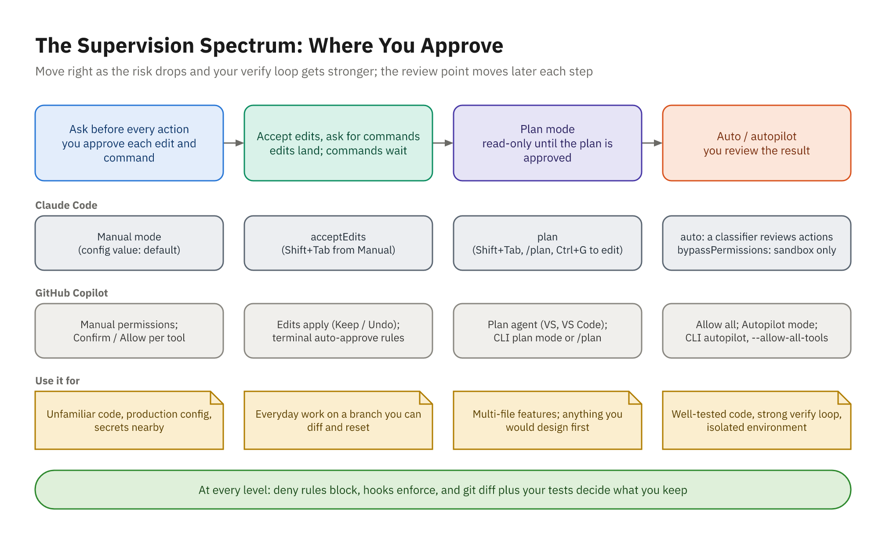

# From Chat to Agents

## What Is an Agent?

- A **tool** is an action the host can run: read, search, edit, run a command
- A **tool call** is the model asking for one; the host runs it, maybe after asking you
- An **agent** is a model in a loop with tools
- A **turn** is one pass through the loop
- A typical feature: ten to a hundred turns
- Chat: **you** paste output, copy code, rerun the build
- Agent: it runs `dotnet test`, edits the file, and tries again itself

## The Loop


## The Tools an Agent Has

- Read and search: gather context first
- Edit and write: make the change
- Terminal: `dotnet build`, `dotnet test`, `git diff`
- Web fetch: check an API it isn't sure about
- MCP tools: issue trackers, databases, internal APIs
- Subagents: hand off a focused subtask
- Every tool call passes through **permissions** you control

# Why .NET Suits Agents

## The Compiler Points at the Problem

```text
PaletteEndpoints.cs(58,23): error CS0103: The name 'PaletteExporter'
    does not exist in the current context
ColorSearchEndpoints.cs(22,55): warning CS8602: Dereference of a
    possibly null reference.
```

- File, line, column, stable ID, readable message
- Hallucinated APIs and missing `using`s die at the first build
- Nullable analysis and analyzers catch what compiles but is wrong

## Tests Report Expected vs Actual

```text
failed ColorMathTests.Rate_maps_ratios_to_wcag_levels(ratio: 4.5, expected: AA)
  Assert.Equal() Failure: Values differ
  Expected: AA
  Actual:   AALarge
```

- The test name, the failing data, and both values
- Close to a perfect bug report

## What the Toolchain Can't Tell It

- Whether a business rule is right: only a test can
- Anything the tests don't check
- Runtime behavior: slow queries, culture bugs, deadlocks
- Rule: **if it matters, make it checkable**, and give the agent the command

# When Is It Done?

## How the Loop Stops

- The model **believes** the task is complete (be skeptical)
- A **limit**: `--max-turns`, `--max-autopilot-continues`, a budget
- **You** stop it: `Esc`, `Ctrl+C`, the stop button
- It's **blocked**: a denied permission, a decision only you can make

## Three Ways It Goes Wrong

- **Premature "done"**: claims success without running the tests
- **Thrashing**: the same error two or three times; stop and add the missing fact
- **Scope creep**: "improves" files the task never mentioned
- Remedies: verification commands, early interruption, file-by-file diff review

## Acceptance Criteria Are the Finish Line

```text
Implement TASK.md: GET /api/palettes/{id}/export?format=css|json|gpl.

Acceptance criteria:
- For Ocean, the CSS and GPL bodies match TASK.md exactly.
- Content types and download names match the TASK.md table.
- Unknown id: 404. Missing or unknown format: 400 naming "format".
- Logic in ToolsApp.Domain with unit tests; API tests for the endpoint.

Verify: dotnet build (no warnings), dotnet test --solution ToolsApp.slnx.
No new packages; don't change existing tests. List the files you changed.
```

## Put the Task in a File

- **Goal**: what and why, two or three sentences
- **Contract**: inputs, outputs, errors, examples
- **Acceptance criteria**: every item checkable
- **Constraints**: packages, tests, patterns to follow
- **Verification**: the exact commands
- Standing rules go in `AGENTS.md` / `CLAUDE.md` / `copilot-instructions.md`

# Your Agent in Depth

## Agent Surfaces

| Surface | Runs on | You are |
|---------|---------|---------|
| IDE agent (VS 2026, VS Code) | Your machine | Watching in the editor |
| Terminal (Copilot CLI, `claude`) | Your machine | Watching beside any IDE |
| Cloud (Copilot cloud agent, Claude Action) | GitHub runner | Reviewing a PR later |

- No Claude Code extension for full Visual Studio: run `claude` beside it

## Sessions

- New task: `/clear` (both CLIs) or a new chat session
- Long task: `/compact keep the approved plan`
- Continue later: `claude --continue`, `/resume`
- What's filling context: `/context`
- One task per session keeps it focused and cheaper

## Watching the Cost

- Copilot: **AI credits**; completions and NES are included
- Chat, agents, the CLI, and the cloud agent consume credits
- Claude Code: `/usage` (aliases `/cost` and `/stats`) for session cost and plan limits
- Biggest lever: **model tier** (`/model`, the model picker)
- Plans change: check the vendors' plan pages, not old slides
- Habits: clean git state, one task per session, interrupt early, review the diff

# Plan Mode and Supervision

## Why Plan First

- Changing a plan costs a sentence; changing code costs a review
- Plan mode: read and explore, **no edits** until you approve
- A good plan lists files, approach, tests, risks, and what's out of scope
- Review it like a design note from a new teammate

## Plan Mode in Each Tool

- **Claude Code**: `Shift+Tab` to `plan mode on`, `/plan <task>`, or `--permission-mode plan`
- Approve with: auto mode / auto-accept edits, manually approve edits, or keep planning
- `Ctrl+G` opens the plan in your editor to change it
- **Copilot**: the **Plan** agent in VS 2026 and VS Code
- Copilot CLI: `Shift+Tab` to plan mode, or `/plan <task>`

## Reviewing a Plan

- Is the logic in the right project (`*.Domain` vs `*.Api`)?
- Does it follow existing patterns, or invent new ones?
- New packages? Real, current, necessary?
- Do the tests cover every acceptance criterion and error case?
- Unhappy paths: concurrency, invalid input, culture, cancellation

## Edit the Plan Before You Approve

```text
Draft:
2. Parse the format with Enum.TryParse<PaletteExportFormat>(...)
3. Build GPL lines with Environment.NewLine
4. Add Swashbuckle so designers can try the endpoint

Edits:
2. Enum.TryParse accepts "1" and "99": use an explicit lookup.
3. GPL requires LF: use "\n".
4. Remove: no new packages.
```

- Each edit is a bug that never got written

## The Supervision Spectrum



## Claude Code Permission Modes

- `default` (**Manual**): reads only; you approve everything else
- `acceptEdits`: edits and common file commands run without asking
- `plan`: research and propose; no edits
- `auto`: a classifier reviews each action; now the default starting mode
- `dontAsk`: only pre-approved tools (CI); `bypassPermissions`: containers only
- Admins can disable auto mode, so don't assume everyone has it

## Copilot Approvals

- VS Code permissions: **Manual**, **Assisted** (experimental), **Allow all**
- **Autopilot** (preview): a mode that keeps going until it decides it's done
- Visual Studio: **Confirm** per tool, for the session, the solution, or always
- `chat.tools.terminal.autoApprove` and `chat.tools.edits.autoApprove` settings
- Copilot CLI: `/permissions`, `--allow-tool`, `--deny-tool`

## Allow and Deny Rules

```json
{
  "permissions": {
    "allow": ["Bash(dotnet test *)", "PowerShell(dotnet test *)"],
    "ask":   ["Bash(git push *)", "PowerShell(git push *)"],
    "deny":  ["Read(./.env)", "Edit(/tests/**)"]
  }
}
```

- Deny, then ask, then allow; deny applies in every mode
- `Bash(...)` rules don't cover the `PowerShell` tool on Windows

## Choosing a Level by Risk

- Can I undo it? Code in a branch vs. migrations, pushes, deployments
- What can it reach? Source only vs. secrets, prod data, network
- How strong are the checks? Good tests vs. none
- How well do I know the code?
- Lab default: plan for the design, accept-edits to build, approve anything leaving the folder
- Autonomy needs a verify loop **and** isolation

## Checkpoints and Rollback

- **Git** always works: commit first, `git diff --stat`, `git restore .`
- Claude Code: `/rewind` or `Esc Esc`: restore code, conversation, or both
- VS Code: **Restore Checkpoint**, then **Redo**; Visual Studio: **Undo** in Total changes
- None of them undo shell commands or external effects (`git push`, a database update)

## Demo 12

- Read `TASK.md`, the context files, and the existing endpoint pattern
- Plan mode: ask for files, approach, format parsing, content types, tests, questions
- Review the plan: `Enum.TryParse`, `Environment.NewLine`, extra packages, hard-coded ids
- Edit it (`Ctrl+G` or "keep planning"), then approve: edits auto-accepted, commands approved
- Watch the build-and-test loop; interrupt if it drifts
- Review `git diff`, run the gates, try the `.http` requests

## Your Turn: Activity 12

- **Plan, Then Let the Agent Build** (Build), Bookstore
- `POST /api/orders` and `GET /api/orders/{id}`: price, take stock, save; all or nothing
- Get a plan first; change at least three things before approving
- Think hard about two orders racing for the last copies
- Judge the result by its tests and its diff

```powershell
.\courseware\utils\start-lab.ps1 -Activity 12
```
