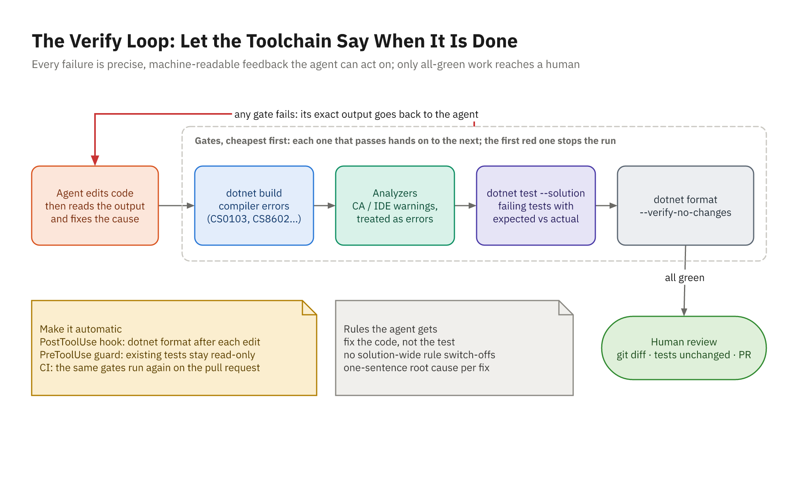

# Make Failure Legible

## Feedback Drives the Loop

- An agent thinks it's done when it can't see anything wrong
- You control what it can see
- Put the compiler, analyzers, tests, and formatter **inside** its loop
- Every problem they detect becomes a message the agent acts on
- Everything they miss reaches your review, or production

## The Four Gates



## Gate 1: A Strict Build

```xml
<PropertyGroup>
  <TargetFramework>net10.0</TargetFramework>
  <Nullable>enable</Nullable>
  <TreatWarningsAsErrors>true</TreatWarningsAsErrors>
  <AnalysisLevel>latest-recommended</AnalysisLevel>
  <EnforceCodeStyleInBuild>true</EnforceCodeStyleInBuild>
</PropertyGroup>
```

- In `Directory.Build.props`: the same rules for people and agents
- Or one-off: `dotnet build -warnaserror`

## Reading Compiler Output

```text
ColorSearchEndpoints.cs(22,55): error CS8602: Dereference of a possibly
    null reference.
```

- File, line, column, ID, message: everything the agent needs
- Nullable warnings as errors: "forgot the null check" becomes a build failure

# Analyzers as Gates

## The Analysis Settings

- `AnalysisLevel`: `latest` by default; `latest-recommended`, `latest-all`
- `EnforceCodeStyleInBuild`: run `.editorconfig` IDE rules in the build
- `TreatWarningsAsErrors`: any warning fails the build
- Severities per rule: `dotnet_diagnostic.CA1305.severity = error`

## What latest-recommended Catches

```text
CA2016: Forward the 'cancellationToken' parameter to 'ToListAsync'
CA1862: Prefer the 'string.Contains' overload that takes a StringComparison
CA1311: Specify a culture or use an invariant version
CA1305: 'string.Format' could vary based on the current user's locale
IDE0161: Convert to file-scoped namespace
```

- From the Demo 13 starter: code that built cleanly under default settings
- Each is a real bug or a team rule

## Errors Arrive in Waves

- A project that fails to build hides its dependents' errors
- Demo 13: 1 error in Domain, then 11 in Api, then 13 in Tests
- New errors after a fix usually mean **progress**
- Tell the agent, or it may undo good fixes

## When a Rule Doesn't Fit

- CA1707 fires 13 times: underscores in **test** method names
- Option 1: rename the tests (edits tests, breaks the rules)
- Option 2: switch CA1707 off everywhere (hides it for real APIs)
- Option 3: scope it to test code and say why (right)

## Scope the Exception

```ini
[tests/**.cs]
# Test names read as sentences; CA1707 is for public API names.
dotnet_diagnostic.CA1707.severity = none
```

```csharp
[SuppressMessage("Performance", "CA1822:Mark members as static",
    Justification = "Injected as a service; callers use the instance API.")]
public Quote Calculate(IReadOnlyList<QuoteLine> lines, string? couponCode = null)
```

# Tests and Format

## Tests the Agent Can Read

```text
failed ColorMathTests.TryParseHex_reads_long_and_short_forms(hex: "#F0A", ...)
  Expected: Rgb { R = 255, G = 0, B = 170 }
  Actual:   Rgb { R = 240, G = 175, B = 10 }
```

- `#F0A` read as `F0AF0A`: the expansion repeats instead of doubling
- Run a subset while iterating: `--filter-class "ToolsApp.Tests.ColorMathTests"`
- Always finish with the full suite

## Count Root Causes, Not Failures

- Activity 13 starts with **8** failing test cases
- They come from **3** root causes
- Fixing case by case is guessing; grouping by cause is debugging
- Ask the agent to group and explain before it edits

## Format as a Gate

```powershell
dotnet format ToolsApp.slnx --verify-no-changes   # exit 0 = clean
dotnet format ToolsApp.slnx                       # apply fixes
dotnet format whitespace --folder --include <file>
```

- `whitespace`, `style`, `analyzers` subcommands
- Best run by a hook after every edit, so nobody has to ask

# Instructing the Agent

## The Verify-Loop Prompt

```text
Turn on warnings-as-errors and latest-recommended analysis, and enforce
code style in the build. Then make these pass, in order:
  dotnet build
  dotnet test --solution ToolsApp.slnx
  dotnet format ToolsApp.slnx --verify-no-changes
Never edit tests to make them pass. No solution-wide rule switch-offs;
scope and justify exceptions. Group failures by root cause and give each
fix a one-sentence cause. Rerun all three gates and show the summaries.
```

## What Good Iteration Looks Like

- Reads the error, names the cause, fixes the cause
- `CA1305`: invariant culture for CSS
- `CS8602`: a 400 for a missing `q`, as `TASK.md` asks
- 3 test failures: expansion indexes, `>` vs `>=`, truncation vs rounding
- No test touched; final summary lines shown

# Fix the Code, Not the Test

## The Shortcuts Agents Take

- Change the expected value to match the actual one
- `[Fact(Skip = ...)]`, delete the test, drop an `[InlineData]` row
- Special-case the input: `if (hex == "#F0A") return ...`
- Swallow the exception the test expects
- `#pragma warning disable` or a solution-wide `NoWarn`

## Layered Defenses

- **Say it**: in the prompt and in `AGENTS.md`
- **Ask**: VS Code `chat.tools.edits.autoApprove` `"**/tests/**": false`
- **Deny**: Claude Code `"deny": ["Edit(/tests/**)"]` (also blocks new tests)
- **Hook**: a `PreToolUse` guard with precise rules
- **Check**: `git diff --stat -- tests/` and CI

## A PreToolUse Guard

```powershell
$payload = [Console]::In.ReadToEnd() | ConvertFrom-Json
$path = $payload.tool_input.file_path
$relative = [IO.Path]::GetRelativePath($root, $path).Replace('\', '/')
if (-not $relative.StartsWith('tests/')) { exit 0 }

git -C $root cat-file -e "HEAD:$relative" 2>$null
if ($LASTEXITCODE -eq 0) {
    [Console]::Error.WriteLine("Blocked: existing test. Fix the code.")
    exit 2    # blocks the edit; stderr goes to the agent
}
```

- Existing tests are read-only; new test files are allowed

## A PostToolUse Format Hook

```json
"PostToolUse": [{
  "matcher": "Edit|Write",
  "hooks": [{
    "type": "command",
    "command": "pwsh",
    "args": ["-NoProfile", "-File",
             "${CLAUDE_PROJECT_DIR}/scripts/format-changed.ps1"],
    "timeout": 120
  }]
}]
```

- In `.claude/settings.json`; the script formats only changed `.cs` files

## The Same Hook for Copilot

```json
{
  "version": 1,
  "hooks": {
    "postToolUse": [{
      "type": "command",
      "matcher": "edit|create",
      "bash": "pwsh -NoProfile -File scripts/format-changed.ps1",
      "powershell": "pwsh -NoProfile -File scripts/format-changed.ps1",
      "timeoutSec": 120
    }]
  }
}
```

- `.github/hooks/*.json`: Copilot CLI and cloud agent; VS Code hooks are preview

## Demo 13

- Show the red start: 1 warning, 3 failing tests, format exit code 2
- Add the `PreToolUse` guard; check it with `/hooks`
- Prompt: strict settings, three gates, the rules
- Watch the waves: CA1305, then the Api errors, then CA1707
- The judgment call: scope CA1707 to tests
- Add the format hook and watch it fix a sloppy edit
- Review: three gates green, `git diff --stat -- tests/`

## Your Turn: Activity 13

- **Drive the Agent to Green** (Fix), Bookstore
- A half-finished migration: coupons, ISBNs, an unreviewed endpoint
- Guard the tests **before** the agent starts
- Strict settings, three gates, a root cause for every fix
- Two judgment calls are yours to make

```powershell
.\courseware\utils\start-lab.ps1 -Activity 13
```
