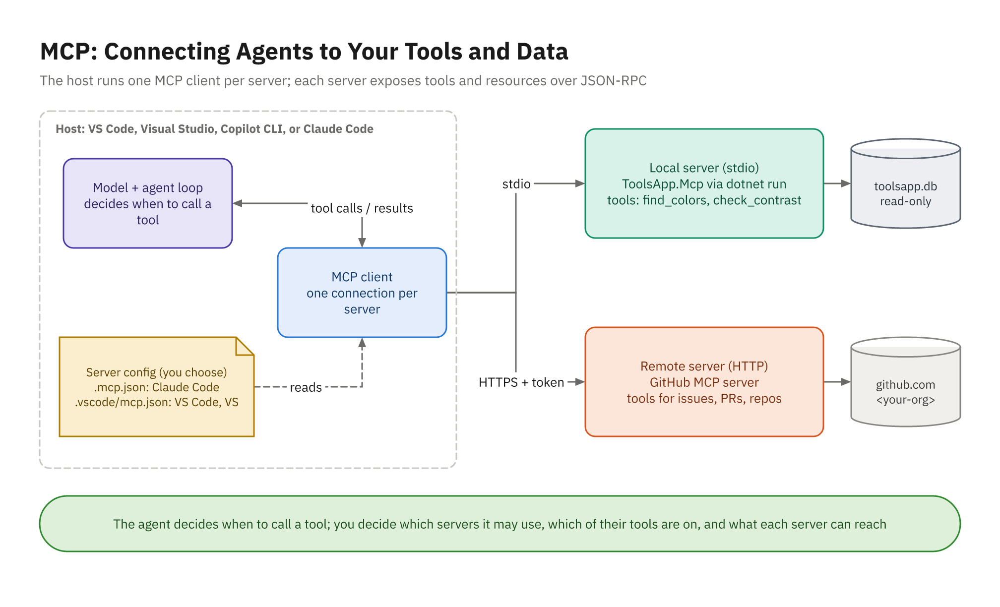

# Packaging Workflows

## Stop Retyping Your Best Prompts

- The review checklist you paste every time
- "Run the gates and don't touch the tests"
- "Add an endpoint the team's way"
- Package them as **files** in the repo: reviewed, versioned, shared
- Every developer and every cloud run gets the same behavior

## Which Mechanism for Which Job

| You want to... | Use |
|----------------|-----|
| Guidance for every task | Instruction files |
| A procedure used now and then | A **skill** |
| A focused job in its own context | A **subagent** / custom agent |
| Something that must always happen | A **hook** |
| A system outside the repo | An **MCP server** |
| Ship a bundle | A **plugin** |

- Instructions and skills **advise**; hooks and permissions **enforce**

# Subagents and Custom Agents

## What a Subagent Is

- A separate agent the main agent delegates to
- Its own **context window**, instructions, tools, and model
- Returns a summary; the main conversation stays focused
- Good jobs: write tests, review a diff, search the codebase
- The **description** decides when it's used

## A Claude Code Subagent

```markdown
---
name: test-writer
description: Writes and runs xUnit v3 tests for ToolsApp code. Use it
  after a domain method, endpoint, or MCP tool changes.
tools: Read, Grep, Glob, Edit, Write, Bash, PowerShell
model: sonnet
---

You write focused, readable xUnit v3 tests for the ToolsApp solution...
```

- `.claude/agents/`; `name` and `description` required
- `/agents` no longer has a wizard: edit the file or ask Claude

## A Copilot Custom Agent

- `.github/agents/test-writer.agent.md`; `description` required
- Visual Studio 2026 (18.4+) and VS Code; personal folders differ
- Leave `tools` out of files both IDEs share: tool names differ
- Pick it in the agent picker; `/agent` in the CLI; when assigning an issue
- VS Code also reads `.claude/agents`

# Hooks

## Hooks Are Deterministic

- Commands the host runs at lifecycle events
- They run **every time**, whatever the model thinks
- `PreToolUse`: before a tool; **can block** it
- `PostToolUse`: after a tool; format, lint
- `Stop`: before finishing; can make the agent **continue**
- Also `SessionStart`, `UserPromptSubmit`, `SubagentStop`, `PreCompact`

## How Hooks Talk to the Agent

- Input: JSON on stdin (`tool_name`, `tool_input.file_path`, `cwd`)
- `CLAUDE_PROJECT_DIR` holds the project root
- Exit 0: carry on
- Exit 2: block (`PreToolUse`, `Stop`); stderr is the reason
- On `PostToolUse`, exit 2 only reports stderr back
- `/hooks` shows what's active

## Hooks in Copilot

- `.github/hooks/*.json`: `version: 1`, camelCase events
- `bash` and `powershell` commands, `timeoutSec`
- `matcher`: a regex on the tool name, for example `edit|create`
- Copilot CLI: all events; cloud agent: a subset, `bash` only
- `preToolUse` denies with `permissionDecision: "deny"`
- VS Code agent hooks: **preview**; Visual Studio: not documented
- Hooks run with your permissions: review them like code

# Skills

## What a Skill Is

- A folder with `SKILL.md`: name, description, steps, optional files
- Only the description is loaded until a task matches
- Invoke by name (`/palette-contrast-report Ocean`) or automatically
- Open standard (agentskills.io): `name` lowercase, matches the folder

## A SKILL.md

```markdown
---
name: palette-contrast-report
description: Builds a WCAG contrast report for one ToolsApp palette,
  using the toolsapp MCP server's find_colors and check_contrast tools.
---

# Palette contrast report

1. Call find_colors with the palette name; keep that palette's colors.
2. Call check_contrast for each color on #FFFFFF and on #000000.
3. Reply with a table: Color | Hex | On white | On black.
Never round a failing ratio up to a threshold.
```

## One Folder, Both Tools

- Claude Code: `.claude/skills/<name>/SKILL.md`; `/skills` lists them
- Copilot reads `.github/skills/`, **`.claude/skills/`**, `.agents/skills/`
- Cloud agent, code review, CLI, VS Code, Visual Studio 18.5+
- One `.claude/skills/` folder serves the whole team
- The description is the trigger: say what and when
- Created the skills folder mid-session? Run `/reload-skills` in Claude Code

# MCP Servers

## What MCP Is

- **Model Context Protocol**: an open standard for agent integrations
- **Host** (VS Code, Visual Studio, CLI, Claude Code) runs one **client** per server
- **Servers** expose **tools**, resources, and prompts
- JSON-RPC over **stdio** (local) or **Streamable HTTP** (remote)
- The agent decides when to call a tool; **you** decide which servers

## MCP Architecture



## Registering a Server

```json
{ "mcpServers": { "toolsapp": {
    "type": "stdio", "command": "dotnet",
    "args": ["run", "--project",
             "${CLAUDE_PROJECT_DIR:-.}/src/ToolsApp.Mcp", "-c", "Release"]
} } }
```

- Claude Code: `.mcp.json`, key **`mcpServers`**; `/mcp` shows status
- `${CLAUDE_PROJECT_DIR:-.}` normally falls back to `.`: start `claude` in the solution root
- Copilot: `.vscode/mcp.json`, key **`servers`**, `${workspaceFolder}`
- VS Code's guided flow labels `.vscode/mcp.json` deprecated; it still works
- `-c Release` keeps the server from locking your Debug build

## A C# Stdio Server

```csharp
var builder = Host.CreateApplicationBuilder(args);

// stdout carries the protocol: every log line goes to stderr.
builder.Logging.AddConsole(o => o.LogToStandardErrorThreshold = LogLevel.Trace);

builder.Services
    .AddMcpServer()
    .WithStdioServerTransport()
    .WithTools<ColorTools>();

await builder.Build().RunAsync();
```

- `ModelContextProtocol` (2.2.0 at the time of writing) + `Microsoft.Extensions.Hosting`

## A Tool Is a Method

```csharp
[McpServerToolType]
public sealed class ColorTools(IColorCatalog catalog)
{
    [McpServerTool(Name = "find_colors", ReadOnly = true)]
    [Description("Finds stored colors whose name, hex, or palette contains " +
                 "the query (case-insensitive). Returns at most 25 matches.")]
    public async Task<IReadOnlyList<ColorMatch>> FindColorsAsync(
        [Description("Text to look for, such as 'sea'.")] string query,
        CancellationToken cancellationToken) => ...
}
```

- Descriptions are written **for the model**; DI fills the constructor
- Test it like any method, with a fake catalog

## Errors the Model Can Use

```text
throw new McpException("query must not be empty.");
  -> "An error occurred invoking 'find_colors': query must not be empty."

throw new InvalidOperationException("...");
  -> "An error occurred invoking 'find_colors'."
```

- Only `McpException` messages reach the model
- Say how to fix the call: "Run the API once to create the database"

## Least Privilege

- Small surface: two lookup tools, not "run any SQL"
- Enforce read-only **below** the tool: `Mode = SqliteOpenMode.ReadOnly`
- Validate input; parameterized SQL; escape `LIKE` wildcards
- Cap results; never return secrets
- `ReadOnly = true` is a hint to clients, not enforcement

## Trusting Servers

- A third-party stdio server is an executable you run: vet it, pin versions
- Tool descriptions and results are **prompts**: prompt injection risk
- Watch for tools that change after approval
- Secrets in `inputs` or environment variables, never in committed config
- Pre-approve only read-only tools: `mcp__toolsapp__find_colors`

# Packaging for the Team

## Commit It, Review It

| | Copilot | Claude Code |
|---|---|---|
| Skills | `.claude/skills/` | `.claude/skills/` |
| Agents | `.github/agents/` | `.claude/agents/` |
| Hooks | `.github/hooks/` | `.claude/settings.json` |
| MCP | `.vscode/mcp.json` | `.mcp.json` |

- CODEOWNERS for agent configuration; personal overrides stay local

## Plugins

- Bundle commands, agents, skills, hooks, and MCP servers
- Claude Code: `.claude-plugin/plugin.json`, `/plugin marketplace add`
- Copilot CLI: plugin marketplaces, for example `microsoft/upgrade-agent-plugins`
- Org-wide Copilot agents: the org's `.github` or `.github-private` repo

## Demo 14

- Open `ToolsApp.Mcp`: stderr logging, read-only SQLite, tool attributes
- Register in `.mcp.json` and `.vscode/mcp.json`; the agent calls `find_colors`
- Add `check_contrast`; review the description and the ratio display
- Have the agent write its own format hook; compare with the reference
- Add the `test-writer` subagent and delegate the new tests
- Add the `palette-contrast-report` skill and run it for Ocean

## Your Turn: Activity 14

- **Extend an MCP Server and Package Workflows** (Extend), Bookstore
- Add `check_stock(isbn)` and `quote_order(lines, coupon)` to `Bookstore.Mcp`
- Reuse `Isbn` and `PriceCalculator`; read-only; errors the model can act on
- Register in both tools; unit-test the tools
- Add a format hook, a reviewer or test-writer agent, and a skill

```powershell
.\courseware\utils\start-lab.ps1 -Activity 14
```
