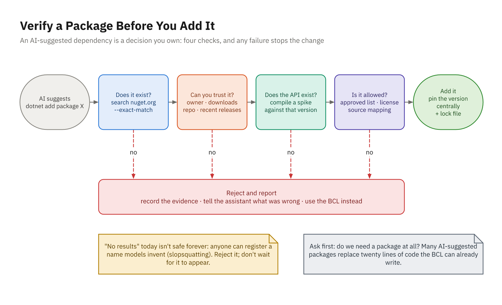
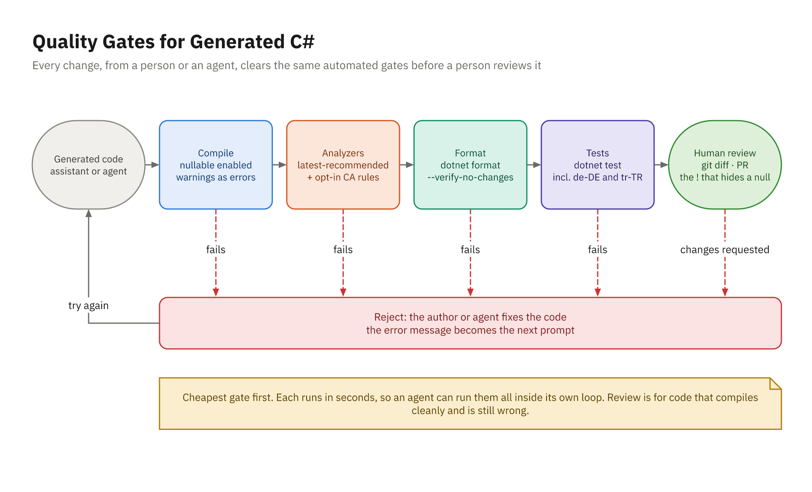

# Hallucinated Packages and APIs

## Why Models Invent Packages

- Package IDs are patterns: `Microsoft.Extensions.X.Y`
- Your own namespace gets recycled: `ToolsApp.ColorSpaces.Extensions`
- Ideas from other ecosystems get "translated" into NuGet names
- Plausible suffixes: `.Extensions`, `.Core`, `.Net`, `.Validators`
- The invention arrives with a confident description and sample code
- Members too: `HttpClient.GetJsonAsync`, `List<T>.RemoveWhere`
- The compiler and `dotnet restore` catch these; the next slide's don't

## Real Package, Wrong Version

```csharp
// Suggested (older CsvHelper API), compiled against 33.1.0:
using var csv = new CsvReader(reader);
csv.Configuration.HasHeaderRecord = true;
// CS1503: cannot convert from 'StreamReader' to 'CsvHelper.IParser'
// CS0200: 'IReaderConfiguration.HasHeaderRecord' ... is read only
```

- Training data blends years of a package's history
- Platform and test tooling too: `Xunit.Abstractions` in xUnit v3, `AddSwaggerGen()`, `IgnoreNullValues`

## Slopsquatting

- Register the names models hallucinate, then wait for installs
- Hallucinations repeat: 205,474 invented names across 16 models; 43% came back on all 10 re-runs
  (USENIX Security 2025; Python and JavaScript, re-runs on Python)
- `NU1101: Unable to find package` today means **reject**, not "try later"
- Prefix reservation protects `Microsoft.*`, not names nobody owns
- Agents can run `dotnet add package` themselves: require approval

## Verify a Package Before You Add It



## The Checks in Practice

```powershell
# 1. Does it exist?
dotnet package search ToolsApp.ColorSpaces.Extensions --exact-match
# No results found.

# 2. Can you trust it? (owner, downloads; then the nuget.org page)
dotnet package search Colourful --take 1

# 3. Does the API compile? A spike outside the solution:
#    spike.cs with #:package CsvHelper@33.1.0
dotnet build spike.cs
```

- Ask first: do we need a package at all?

## Adding One Properly

- Version in `Directory.Packages.props` only, never in a `.csproj`
- Lock file: `RestorePackagesWithLockFile`; CI restores with `--locked-mode`
- NuGet Audit runs on restore: `NU1901`–`NU1904`, transitive by default on `net10.0`
- `dotnet package list --vulnerable --include-transitive`
- `dotnet nuget why ToolsApp.slnx <package>`
- .NET 11 (RC2; GA due November): a per-source `minPublishAgeHours` cooldown in `nuget.config`
- Record the decision where reviewers can find it

## Make the Rules Stick

```markdown
- Never add a NuGet package without asking first. Prefer the BCL.
- Before proposing a package, run `dotnet package search <id> --exact-match`
  and show the output; get owner, downloads, and repository without the flag.
- If a search finds nothing, say so and stop.
```

- Copilot: `chat.tools.terminal.autoApprove` entry set to `false` for package installs
  (default permission level only; Allow all and Autopilot skip it)
- Claude Code: `ask` rules for `Bash(dotnet add package *)` and, on Windows, `PowerShell(dotnet add package *)`
- Visual Studio 2026 has a built-in NuGet MCP server for live package data

# Stale Framework Knowledge

## The Model Trails the Platform

- .NET 10 and C# 14 (November 2025) are thin in training data
- .NET 11 and C# 15: RC2 shipped October 13, 2026; GA expected November 10, 2026
- Fifteen years of .NET Framework answers outweigh a year of .NET 10
- Old code still compiles, so staleness ships quietly
- A model's claim about its own cutoff is itself a guess

## What Stale Looks Like

| The model writes | .NET 10 wants |
|------------------|---------------|
| `WebClient` (`SYSLIB0014`) | `HttpClient` via `IHttpClientFactory` |
| `IgnoreNullValues` (`SYSLIB0020`) | `DefaultIgnoreCondition = WhenWritingNull` |
| `new SHA256Managed()` (`SYSLIB0021`) | `SHA256.HashData(bytes)` |
| `Startup`, Swashbuckle, Newtonsoft | Minimal hosting, `AddOpenApi()`, System.Text.Json |
| A hand-rolled validation filter | `builder.Services.AddValidation()` |
| A private backing field | The C# 14 `field` keyword |

## Grounding the Model

- Pin TFM and versions in context files; don't set `LangVersion` to `latest` or `preview`
- Paste the relevant Learn section, or let the agent fetch the page
- Connect the Microsoft Learn MCP Server: `https://learn.microsoft.com/api/mcp`
- Ask for links you can open; no link means unverified
- Settle version questions with a file-based app: `dotnet run field.cs`
- The compiler, analyzers, and tests are the source of truth

## The Learn MCP Server

| | GitHub Copilot | Claude Code |
|---|---|---|
| **Config** | `.vscode/mcp.json` or `<SolutionDir>\.mcp.json`, key `"servers"` | `claude mcp add --transport http microsoft-learn https://learn.microsoft.com/api/mcp` |
| **Auth** | None; public and free | None |
| **Check** | Tools picker shows its tools | `/mcp` shows it connected |

```text
Use the Microsoft Learn MCP server to check how ASP.NET Core 10 minimal APIs validate
request bodies, and link the page you used.
```

# Warnings as Quality Gates

## Every Change Clears the Same Gates



## `!` Is a Code Smell

```csharp
var palette = await db.Palettes.Include(p => p.Colors).AsNoTracking()
    .FirstOrDefaultAsync(p => p.Id == id, cancellationToken);
foreach (var color in palette!.Colors)      // unknown id: 500, not 404

if (palette is null) { return TypedResults.NotFound(); }   // reviewed
```

- `!` silences `CS8602` and changes nothing at runtime
- Prefer null checks, `is { } x`, `required`, `ThrowIfNull`, `[NotNullWhen]`
- `<WarningsAsErrors>nullable</WarningsAsErrors>`; review every new `!`

## Turn On the Gates

```xml
<PropertyGroup>
  <TreatWarningsAsErrors>true</TreatWarningsAsErrors>
  <AnalysisLevel>latest-recommended</AnalysisLevel>
  <EnforceCodeStyleInBuild>true</EnforceCodeStyleInBuild>
  <!-- New NuGet advisories warn instead of breaking every build -->
  <WarningsNotAsErrors>$(WarningsNotAsErrors);NU1901;NU1902;NU1903;NU1904</WarningsNotAsErrors>
</PropertyGroup>
```

- Demo 21's starting code: **1 warning** by default, **18 errors** with the gates (19 with `CA1849` opted in)
- Each error message is a precise prompt for the agent

## Rules That Catch AI Mistakes

| In `latest-recommended` | Opt in | Policy |
|-------------------------|--------|--------|
| `CA2016` forward the token | `CA1849` sync over async | `CA2007` ConfigureAwait |
| `CA1305`, `CA1310` culture | `CA2000` dispose | |
| `CA1304`, `CA1311` casing | `CA1851` multiple enumeration | |
| `CA1848`, `CA2254`, `CA1873` logging | | |
| `CA1869` JsonSerializerOptions | | |

- `latest-all` is too noisy; opt in rule by rule in `.editorconfig`
- `CA2007`: usually off for ASP.NET Core apps, on for libraries

## Culture Bugs Hide on en-US Laptops

```csharp
// Server culture de-DE:
decimal.Parse("18.99");                                 // 1899
decimal.Parse("18.99", CultureInfo.InvariantCulture);   // 18.99

// Culture tr-TR:
"Indigo".ToLower(CultureInfo.GetCultureInfo("tr-TR"));  // "ındigo"
"Indigo".ToLowerInvariant();                            // "indigo"
```

- Data formats (CSV, ISBNs, CSS names): invariant culture, ordinal comparison
- Prove it with a test that runs under `de-DE` or `tr-TR`

## Logging the Modern Way

```csharp
// AI: CA2254, CA1848, CA1873
logger.LogInformation($"Imported {imported} colors into palette {id}.");

// Reviewed: source-generated, structured, no allocation when disabled
[LoggerMessage(Level = LogLevel.Information,
    Message = "Imported {Count} colors into palette {PaletteId}")]
private static partial void LogImported(ILogger logger, int count, int paletteId);
```

- `Count` and `PaletteId` stay searchable fields in your log store

# EditorConfig and dotnet format

## Severity and Scope

```ini
[*.cs]
csharp_style_namespace_declarations = file_scoped:warning
dotnet_diagnostic.CA1849.severity = warning
dotnet_diagnostic.CA2000.severity = warning

[tests/**/*.cs]
# Test names are sentences by convention; nothing calls them by name.
dotnet_diagnostic.CA1707.severity = none
```

- Only `warning` and `error` gate a command-line build
- `EnforceCodeStyleInBuild` makes `IDExxxx` rules run in the build

## `dotnet format` as a Gate

```powershell
dotnet format ToolsApp.slnx --verify-no-changes
# error IDE0161: Convert to file-scoped namespace
# error CA1310: The behavior of 'string.StartsWith(string)' could vary ...
$LASTEXITCODE   # 2
```

- Reports only what it can fix: 7 of the build's 19 findings (18 + opt-in `CA1849`)
- Run it **with** the build: in CI, and as an agent hook after edits

## Suppressions Done Right

- 1: Fix the code
- 2: Scoped `.editorconfig` severity, reason in a comment
- 3: `[SuppressMessage(..., Justification = "...")]` on one member
- 4: `#pragma warning disable` around the fewest lines, then `restore`
- 5: `GlobalSuppressions.cs` with a narrow `Target`
- 6: `<NoWarn>`: last resort, and a red flag in any AI diff
- Tell the agent: never suppress without asking

# Performance Review

## The AI Suggests, the Benchmark Decides

- AI code favors readable LINQ: re-parsing in loops, a record per item, `ToList()` everywhere
- The line that looks worst often isn't: measure which one matters
- Measure first: BenchmarkDotNet, `[MemoryDiagnoser]`, Release builds only
- Keep the original as the baseline, and prove identical results with tests
- Ask for optimizations, then measure again
- Reject any "optimization" that doesn't measurably help
- Bonus Demo 09 and Bonus Activity 09 practice the whole loop

# Demo and Practice

## Demo 21

- `start-lab.ps1 -Demo 21 -Open`; the build shows one warning, 18 tests pass
- Step 1: verify `ToolsApp.ColorSpaces.Extensions`: no results, reject
- Verify the agent's alternative too; do we need a package at all?
- Step 2: implement HSL with the BCL; round-trip test over every color
- The suggestion's example output was wrong too: `#F3D8AA`, not `#F4D8A8`
- Step 3: gates on; the agent fixes 18 errors, then stops at `CA1707`
- Step 4: review what no gate saw: two `!` (500 not 404), a silent partial import

## Your Turn: Activity 21

- **Verify, Then Gate** (Fix), Bookstore theme
- Verify `Isbn13.Net` and CsvHelper with evidence in `VERIFICATION.md`
- Rebuild the supplier price import to the spec in `TASK.md`, no new packages
- Culture-proof prices, ISBN-10 conversion, all-or-nothing validation
- Gates on, zero warnings, scoped suppressions with reasons

```powershell
.\courseware\utils\start-lab.ps1 -Activity 21
cd ~\labs\activity-21-csharp-pitfalls-and-verification
```
