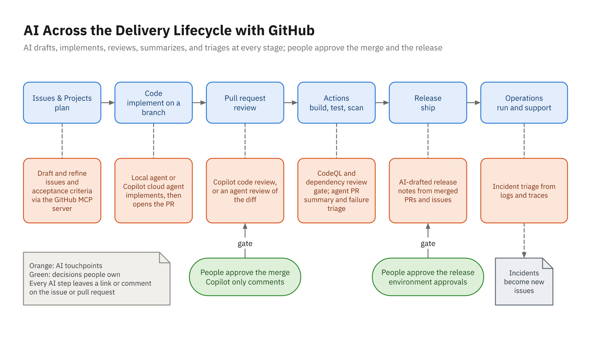
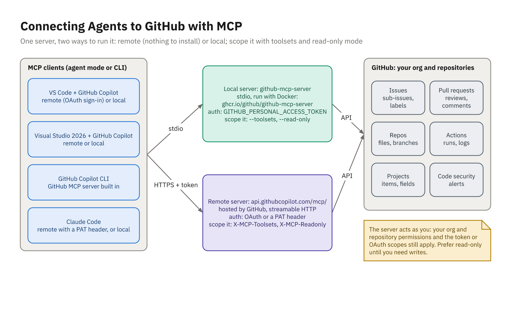

# AI Across the Delivery Lifecycle

## The Lifecycle



## Mature or Emerging (October 2026)

| Capability | Status |
|------------|--------|
| GitHub MCP server, remote and local | GA |
| Copilot code review, requested or by ruleset | GA, paid Copilot plan |
| Copilot approving pull requests | **Public preview**, off by default |
| Issue → Copilot cloud agent → pull request | GA (Bonus Demo 04) |
| GitHub Agentic Workflows (`gh aw`) | **Public preview** |

- Preview: pilot it, give it a fallback, don't depend on it

## People Stay Accountable

- Acceptance criteria: the product owner decides what "done" means
- The merge: Copilot's review is a comment; a person approves and merges
- The release: environment approvals, not an AI draft
- Security alerts: dismissed by people with permission, not "fixed" by suppression
- Incidents: the on-call engineer decides
- Every AI step produces a draft; a person signs it

## Traceability

- Issue ↔ branch ↔ commits ↔ pull request ↔ checks
- Matters more when an agent wrote part of the diff
- `gh issue develop 412`: a branch the issue already knows about
- `(#412)` in commit messages; `Fixes #412` in the pull request description
- Label AI-assisted work consistently, or don't bother
- Say how AI was used in the pull request description

# Connecting Agents to GitHub

## One Server, Two Ways to Run It



## Remote or Local

| | Remote | Local |
|---|---|---|
| **Runs** | Hosted: `api.githubcopilot.com/mcp/` | `ghcr.io/github/github-mcp-server`, stdio |
| **Needs** | Nothing to install | Docker |
| **Auth** | OAuth sign-in, or a token header | Browser sign-in, or `GITHUB_PERSONAL_ACCESS_TOKEN` |
| **Toolsets** | `X-MCP-Toolsets` header | `--toolsets` |
| **Read-only** | `X-MCP-Readonly: true` | `--read-only` |

- Both act as you; teach remote first, keep local as the fallback
- Copilot CLI has the server built in

## VS Code and Visual Studio

```json
{
  "servers": {
    "github": {
      "type": "http",
      "url": "https://api.githubcopilot.com/mcp/",
      "headers": {
        "X-MCP-Toolsets": "context,issues,pull_requests,repos,copilot"
      }
    }
  }
}
```

- `.vscode/mcp.json`, key `"servers"`: read by VS Code and Visual Studio 2026
- Sign in with your GitHub account: no token in the file

## Claude Code

```json
{
  "mcpServers": {
    "github": {
      "type": "http",
      "url": "https://api.githubcopilot.com/mcp/",
      "headers": {
        "Authorization": "Bearer ${GITHUB_PAT}",
        "X-MCP-Toolsets": "context,issues,pull_requests,repos,copilot"
      }
    }
  }
}
```

- `.mcp.json` holds the variable's name; `GITHUB_PAT` is a user environment variable
- Fine-grained token: class org, all repos; Contents, Issues, PRs read/write; 7 days

## Toolsets: Load What the Task Needs

- Defaults: `context`, `repos`, `issues`, `pull_requests`, `users`
- Naming toolsets replaces the defaults: list `context` to keep `get_me`
- `copilot` only for `request_copilot_review`
- No `actions`, `projects`, or `code_security`: those tools don't exist here
- Refinement-only session: add `X-MCP-Readonly: true`
- `/mcp` (Claude Code) or the tool picker shows what actually loaded

## Least Privilege in Layers

```jsonc
{ "permissions": {
    "allow": ["mcp__github__get_me", "mcp__github__issue_read",
              "mcp__github__list_issues"],
    "ask":   ["mcp__github__issue_write", "mcp__github__create_branch",
              "mcp__github__create_pull_request"],
    "deny":  [ /* the next slide's list */ ] } }
```

- Identity → token scope → toolsets → client approvals
- Write tools the task uses ask first; the ones it never needs are denied
- Write tools have no common suffix: read the tool list
- Copilot: Confirm per call in VS; Manual permissions in VS Code

## Deny What the Task Never Needs

| Tools | Why deny them |
|-------|---------------|
| `merge_pull_request` | A person merges |
| `push_files`, `create_or_update_file`, `delete_file` | API commits skip your build and tests |
| `create_repository`, `delete_repository`, `fork_repository` | Repository-level: no issue-to-PR task needs them |
| `assign_copilot_to_issue`, `create_pull_request_with_copilot` | They hand the work to the cloud agent |

- Claude Code: `mcp__github__<tool>` in `deny`
- VS Code: untick the same tools in the tool picker

# GitHub Issues with AI

## Fluent but Undecided

```text
As a user, I want to rename palettes so that I can organize my colors.
- The user can rename a palette.
- Duplicate names are not allowed.
- The API returns an appropriate error for invalid input.
```

- *Illustrative* first draft: reads well, decides nothing
- "Ocean" vs "ocean"? 400 or 409? Rename to your own name?
- An agent picks answers, and its tests enshrine them

## Ask Before Writing

```text
Read ISSUE-DRAFT.md. Before writing anything, list the
questions a product owner must answer to make this testable.
Then wait.
```

```text
Decisions: duplicates ignore case and surrounding whitespace;
a taken name returns 409 with problem details; ...
Write numbered Given/When/Then criteria with concrete values.
```

- The product owner answers, not the model

## Criteria a Test Can Use

```text
4. A palette may change the casing of its own name.
   Given the palette "Ocean" exists,
   when I rename it to "OCEAN",
   then the response is 200 OK and the name is "OCEAN".
```

- Concrete data, one behavior, boundaries stated
- Status codes and error shapes for APIs
- An out-of-scope list: agents love extra features
- Copy in `docs/issues/`; the GitHub issue stays the source of truth

## Issues Through MCP

- `issue_write` creates and updates issues, labels included
- Name the repository; see the title, body, and labels before any write
- Read it back with `issue_read`: formatting doesn't always survive
- Create labels once with `gh label create`
- Split big stories into sub-issues (`sub_issue_write`) after approval
- Issue forms keep human-written issues in shape (Bonus Demo 04)

## Linking the Work

| Link | How |
|------|-----|
| **Branch** | `gh issue develop 412 --checkout` |
| **Commit** | `(#412)` at the end of the message |
| **Pull request** | `Fixes #412` in the description |
| **Close on merge** | Closing keyword, merged into the default branch |
| **See it** | The issue's **Development** panel and timeline |

- The agent can do all of it; you check the panel

# Copilot Code Review on GitHub

## What It Does

- Reviewers > **Copilot**, or `request_copilot_review` through MCP
- Comments on lines, with suggested changes to commit
- A comment, not an approval: required approvals still need a person
- Re-review: request again, or a ruleset with **Review new pushes**
- Needs a paid Copilot plan; uses GitHub AI Credits
- Private repositories: each review also uses Actions minutes
- "Copilot can approve" is a public preview: leave it off

## Make It Automatic

| Setting | Value |
|---------|-------|
| Where | Settings > Rules > Rulesets |
| Ruleset | New branch ruleset, targeting the default branch |
| Rule | **Automatically request Copilot code review** |
| Options | **Review new pushes**; draft pull requests |

- Enabling Code Quality no longer creates this ruleset for you
- Pair it with "Require a pull request before merging" and approvals

## Instructions It Reads

| Level | Where |
|-------|-------|
| Repository | `.github/copilot-instructions.md`, `AGENTS.md` |
| Path | `.github/instructions/*.instructions.md` with `applyTo` |
| Opt out | `excludeAgent: "code-review"` in a path file |

- Read from the pull request's **head** branch
- So a pull request that changes the rules is reviewed with them
- The same files steer Copilot chat in the IDE

## A Path-Scoped Rule

```markdown
---
applyTo: "src/ToolsApp.Api/**/*.cs"
---
- Return TypedResults; list every outcome in Results<...>.
- 409 (problem details) when a valid request conflicts,
  such as a duplicate name.
- Pass the CancellationToken to every EF Core call.
- Palette names are unique ignoring case: compare
  p.Name == name; don't call ToLower() on the column.
```

- No `applyTo`, no effect

## Acting on the Comments

| The comment is | Do this |
|----------------|---------|
| Right, suggestion right | Apply, then build and test |
| Right, suggestion wrong | Fix it your way; resolve with a note |
| Wrong for this codebase | Resolve; add a "Don't" to the instructions |
| Noise | Resolve; tighten the instructions |

- No comments isn't approval
- Track the hit rate for a few weeks

## The Fallback

```text
Review git diff main...HEAD strictly against
.github/copilot-instructions.md, the .instructions.md files
whose applyTo patterns match, and docs/issues/. For each
finding give file, line, problem, and fix. Don't edit files.
```

- A **fresh** session: the writer is the worst reviewer
- Works with Copilot chat or Claude Code, on any plan

# Local Agent or Cloud Agent

## Three Ways from Issue to Pull Request

| | Local agent + MCP | Copilot cloud agent | Claude Code Action |
|---|---|---|---|
| **Runs** | Your IDE or terminal | A GitHub-hosted runner | A runner, in your workflow |
| **You** | Watch and approve each write | Review the finished PR | Review the finished PR |
| **Starts from** | A prompt that names the issue | The issue assigned to Copilot | An `@claude` mention |
| **Shown in** | Demo 22, Activity 22 | Bonus Demo 04 | Bonus Demo 04 |

- Either way: the issue is the specification
- Either way: the pull request gets a normal, human review

# Demo and Practice

## Demo 22

- Connect the remote GitHub MCP server; prove it with a read-only question
- Agent lists the open questions; the PO answers; the issue is created through MCP
- Review instructions and MCP config committed to `main` before branching
- `gh issue develop`, then plan and implement `PATCH /api/palettes/{id}`
- Remove `NOCASE`: the case-insensitive 409 tests fail
- Open the pull request through MCP with `Fixes #<number>`
- Copilot code review or the fresh-session fallback
- A person approves and merges; the issue closes
- Walkthrough: `courseware/demos/22-github-mcp-and-issues/`

## Your Turn: Activity 22

- **Issue to PR with the GitHub MCP Server** (Configure), Bookstore
- Pre-orders: future `PublishedOn` can be quoted, not stocked
- Configure the server: five toolsets, writes ask, no token in files
- Refine the draft into Given/When/Then; create the issue through MCP
- Instructions on `main`, fixed-clock tests, linked PR, then review

```powershell
.\courseware\utils\start-lab.ps1 -Activity 22
cd ~\labs\activity-22-github-mcp-and-issues
```
