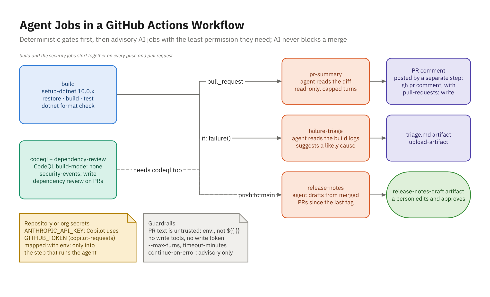

# Agents in GitHub Actions

## Text for a Person

- Headless agents run one prompt to completion: `claude -p`, `copilot -p`
- Nobody watches the run, so the useful jobs produce **text for a person**
- PR summaries, failure triage, release notes
- Gates decide whether code merges; AI jobs only advise
- Design so a wrong or manipulated model can't do harm
- Pin the CLI versions you tested; flags change between releases
- Emerging: GitHub Agentic Workflows (`gh aw`, public preview)

## The Workflow Shape



## Gates Decide, AI Advises

| Job | Runs when | Output |
|-----|-----------|--------|
| `build` | Every run | Pass/fail; logs as an artifact, even on failure |
| `codeql` | Every run, beside `build` | Code scanning alerts; a ruleset gate |
| `dependency-review` | Pull requests | Fails on vulnerable packages |
| `pr-summary` | `pull_request` | PR comment |
| `failure-triage` | `if: failure()` | `ai-triage` artifact, PR comment |
| `release-notes` | Push to `main` | Draft artifact for a person |

- Every AI job: `continue-on-error: true` and `timeout-minutes`; never a required check

## Claude Code or Copilot CLI

| | Claude Code | Copilot CLI |
|---|---|---|
| **Run** | `claude --bare -p` | `copilot -p -s --no-ask-user` |
| **Input** | Piped on stdin | A file in a scratch folder |
| **Credential** | `ANTHROPIC_API_KEY` secret | `GITHUB_TOKEN` + `copilot-requests: write` |
| **Tools** | `--tools ""` or `"Read"` | `--deny-tool`, `--disable-builtin-mcps`, `--disallow-temp-dir` |
| **Repo config** | `--bare` skips `CLAUDE.md` | `--no-custom-instructions` skips `AGENTS.md` |
| **Caps** | `--max-turns`, `--max-budget-usd` | `--max-ai-credits` (soft cap), `timeout-minutes` |

- Copilot CLI usage bills to the **organization**, in AI credits
- `--bare`, `--no-custom-instructions`: the PR can't instruct its own reviewer
- `--disallow-temp-dir`: file reads stay in the scratch folder

## Workflow Building Blocks

- Top level: `permissions: contents: read`
- Write scopes on the job that needs them: `pull-requests: write`, `security-events: write`
- Secrets in repository or organization secrets
- Map each secret with `env:` into **one** step, never job or workflow `env:`
- Fork pull requests: no secrets, read-only token; skip with a warning
- `fetch-depth: 0` to diff against the base branch
- `persist-credentials: false` keeps the token out of `.git/config`
- `concurrency` per pull request cancels superseded runs

## Script Injection

```yaml
# Wrong: GitHub pastes the title into the script before pwsh runs
- run: Write-Output "Reviewing ${{ github.event.pull_request.title }}"

# Right: the title is data in an environment variable
- env:
    PR_TITLE: ${{ github.event.pull_request.title }}
  run: Write-Output "Reviewing $env:PR_TITLE"
```

- A title like `"; curl ... #` would run on your runner
- Same for `body`, `github.head_ref`, issue and comment text
- Never `pull_request_target` next to pull request code

## The Summary Job: Run the Agent

```yaml
pr-summary:
  needs: build
  if: ${{ !cancelled() && github.event_name == 'pull_request' }}
  permissions: { contents: read, pull-requests: write }
  steps:
    - id: summary
      env: { ANTHROPIC_API_KEY: "${{ secrets.ANTHROPIC_API_KEY }}" }
      run: |
        $work = "$env:RUNNER_TEMP/ai"
        Get-Content -Raw $work/pr-input.md |
          claude --bare -p (Get-Content -Raw ci/prompts/pr-summary.md) --tools "" `
            --model sonnet --max-turns 4 --max-budget-usd 0.50 |
          Out-File $work/pr-summary.md
        if ($LASTEXITCODE -eq 0) { 'ready=true' >> $env:GITHUB_OUTPUT }
```

- Plus `timeout-minutes: 10` and `continue-on-error: true`
- `--tools ""`: the model can only return text; `ready` only on a clean exit

## The Summary Job: Post the Result

```yaml
# pr-summary, continued: two more steps
- if: ${{ steps.summary.outputs.ready == 'true' }}
  uses: actions/checkout@v7
  with:
    ref: ${{ github.event.pull_request.base.sha }}   # the base's script
    path: base
    persist-credentials: false
- if: ${{ steps.summary.outputs.ready == 'true' }}
  env:
    GH_TOKEN: ${{ github.token }}
    PR_NUMBER: ${{ github.event.pull_request.number }}
  run: |
    ./base/scripts/post-pr-comment.ps1 -BodyPath $env:RUNNER_TEMP/ai/pr-summary.md `
      -PullRequest $env:PR_NUMBER -Marker ai-pr-summary
```

- The script that holds the write token comes from the **base** commit

## Posting to the Pull Request

```powershell
gh pr comment $PullRequest --repo $env:GITHUB_REPOSITORY --body-file $file
gh api --method PATCH "repos/$repo/issues/comments/$id" -F "body=@$file"
```

- A separate step posts: it holds `GH_TOKEN`, the agent step doesn't
- It runs the posting script from the base commit, never a model
- Update the earlier comment (found by a marker) instead of one per push
- Footer: "AI-generated and not verified by a person"
- Post only after a clean exit: a failed run's error is on stdout
- `-WhatIf` prints the command and body without calling GitHub

## Failure Triage

```yaml
# In build: always keep the logs
- if: ${{ !cancelled() }}
  uses: actions/upload-artifact@v7
  with: { name: build-logs, path: logs/ }

failure-triage:
  needs: build
  if: ${{ failure() }}
```

- Pipe the log tails; `--tools "Read"` with `dontAsk`: reads inside the checkout only
- No `--allowedTools "Read"`: a bare `Read` rule allows any file, even `/proc/self/environ`
- Prompt: never suggest skipping tests or suppressing warnings
- Upload `ai-triage`; comment only on pull request runs

## PR Text Is Untrusted

- Title, description, diff, comments, commit messages: written by the PR author
- Prompt injection (OWASP LLM01) plus excessive agency (LLM06)
- No tools, or read-only; `--bare` ignores the PR's `CLAUDE.md`
- Key only in the agent step; token only in the posting step
- Advisory output, labeled "AI-generated, not verified"
- Same-repo PRs run their own `ci.yml` with secrets: whoever can push is trusted
- `CODEOWNERS` gates the merge, not the run; fork PRs get no secrets
- Stronger: secrets in an environment with required reviewers

## Cost Controls

- **Run less:** PRs, failures, `main`; skip PRs that don't touch `src/`
- **Send less:** cap the diff, log tails, skip lock files
- **Choose the tier:** balanced for summaries and triage
- **Cap runs:** `--max-turns`, `--max-budget-usd`, `--max-ai-credits`, `timeout-minutes`
- **Cap accounts:** Console workspace limit, AI credit budgets
- **Measure:** `--output-format json` reports `total_cost_usd`

## Verify Offline

```powershell
dotnet run --file tools/check-workflow.cs -- .github/workflows/ci.yml
# OK   .github/workflows/ci.yml parses. Jobs: build, codeql, dependency-review, ...
# All checks passed.

dotnet run --file tools/check-workflow.cs -- bad-ci.yml
# FAIL bad-ci.yml: top-level permissions: write-all lets every job write; ...
# FAIL bad-ci.yml: job pr-summary, step #3: ${{ github.event.pull_request.title }} ...
# 6 problem(s) found.

./scripts/post-pr-comment.ps1 -BodyPath sample.md -PullRequest 1 -WhatIf
```

- A workflow runs only on GitHub; check what you can first
- Then a test pull request, then one real repository

# GitHub Advanced Security

## Two Products

| Product | Includes |
|---------|----------|
| GitHub Code Security | **CodeQL** code scanning, **Copilot Autofix**, dependency review, security campaigns |
| GitHub Secret Protection | Secret scanning, **push protection**, custom patterns |

- Free on public repositories; private ones need the licenses
- Results: Security > Code scanning, plus pull request annotations
- CodeQL **default setup** needs no YAML; **advanced setup** lives in the workflow
- Use one setup per repository, never both

## CodeQL Without a Build

```yaml
codeql:
  permissions:
    contents: read
    actions: read
    security-events: write
  steps:
    - uses: actions/checkout@v7
    - uses: github/codeql-action/init@v4
      with:
        languages: csharp
        build-mode: none
    - uses: github/codeql-action/analyze@v4
```

- No build, so it runs beside `build` and reports even when the build fails

## Merge Protection with a Ruleset

| Layer | Catches | When |
|-------|---------|------|
| `-warnaserror` analyzers | `EF1002`, obsolete APIs | Build, seconds |
| NuGet Audit, dependency review | Vulnerable packages | Restore, pull request |
| CodeQL | Data flow, injection | Every run, minutes |
| Push protection | Secrets | Push |

- Ruleset: **Require status checks to pass** (`Build and test`, `Dependency review`)
- **Require code scanning results**: CodeQL, High or higher
- Add it after the first run, so the check names exist

## The Planted Bug

```csharp
// Generated by an AI assistant for review: not yet reviewed.
var colors = await db.Colors
    .FromSqlRaw($"SELECT * FROM Colors WHERE Name LIKE '%{name}%'")
    .Include(c => c.Palette)
    .AsNoTracking()
    .ToListAsync(cancellationToken);
// warning EF1002 ... interpolated strings directly into the SQL
```

- `?name=' OR 1=1 --` returns every color
- The old workflow passes; `-warnaserror` fails the build; CodeQL raises an alert

## Copilot Autofix

- Alert > **Generate fix**: a suggested patch with an explanation
- Also on pull requests that introduce an alert
- Free on public repositories; private ones need Code Security
- **Agentic autofix** (GitHub Enterprise Cloud): a validated fix PR, in Code Security AI credits
- Fallback: an agent fixes the alert from the IDE, with attacking tests
- Review it like any pull request; the next scan confirms the fix

## The Agent Fix

```csharp
var pattern = $"%{EscapeLike(name)}%";   // sent as a SQL parameter

var colors = await db.Colors
    .Include(c => c.Palette)
    .AsNoTracking()
    .Where(c => EF.Functions.Like(c.Name, pattern, LikeEscape))
    .OrderBy(c => c.Name)
    .ToListAsync(cancellationToken);
// WHERE "c"."Name" LIKE @pattern ESCAPE '\'
```

- `Contains` would be case-sensitive on SQLite (`instr`)
- Tests: `sea`, `DEEP`, `' OR 1=1 --`, `%`, `_`; no suppressions

# Cost Visibility

## Where AI Costs Land

| Usage | Billed to | Track it in |
|-------|-----------|-------------|
| Copilot seats | GitHub organization or enterprise | Billing, cost centers |
| Copilot CLI in a workflow | The organization, in AI credits | Billing usage, budgets |
| Agentic autofix, AI Scan | Code Security AI credits | Enterprise billing (*Advanced Security*), SKU budgets |
| Actions minutes (private repositories) | GitHub | Billing usage, budgets |
| Claude Code API key | Claude Console | Workspaces, spend limits |

- Copilot usage is metered in GitHub AI Credits (since June 1, 2026)
- A dedicated Console workspace per CI key gives per-project costs

## Estimating a Summary

```text
input:  20,400 tokens x $2  / 1M = $0.041
output:    600 tokens x $10 / 1M = $0.006
                        per run ~ $0.047
900 PR runs a month             ~ $42
```

- Illustrative: `sonnet` (Claude Sonnet 5.5) at $2 / $10 per million tokens, at the time of writing
- Input dominates: capping the diff is the best lever
- Measure two weeks on one repository, then size budgets

# Demo and Practice

## Demo 23

- Start: a build-and-test workflow passes a SQL injection
- Agent writes the gated workflow; review it for GitHub pitfalls
- Verify offline: `check-workflow.cs` and `-WhatIf`
- Push: `-warnaserror` fails the build; triage explains `EF1002`; CodeQL alerts
- Ruleset on `main`; Autofix, or an agent fix with attacking tests
- PR: gates pass, summary posted; merge: release notes drafted

## Your Turn: Activity 23

- **Put an Agent in the Workflow** (Build), Bookstore
- Gates: build with warnings as errors, tests, format, CodeQL, dependency review
- Risk review on PRs that touch `src/`: pricing, stock, tests
- Claude Code or Copilot CLI, picked by the `AI_AGENT` variable
- Failure triage; one secret per step; caps on every run

```powershell
.\courseware\utils\start-lab.ps1 -Activity 23
cd ~\labs\activity-23-ai-in-github-actions-and-ghas
```
